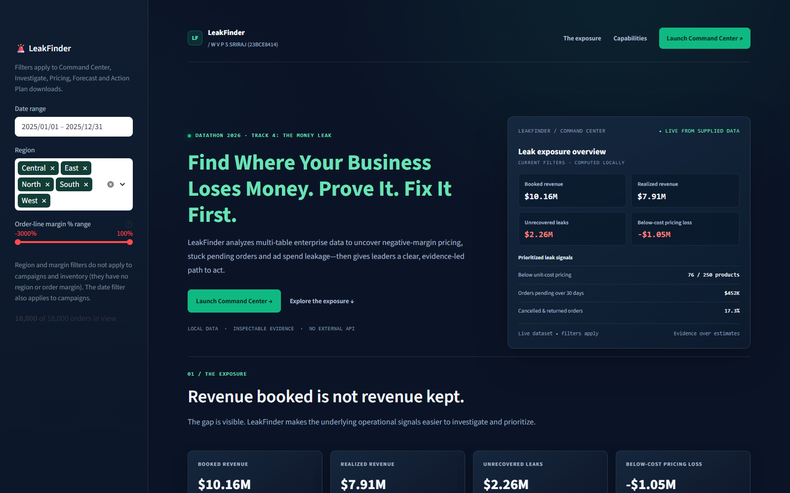
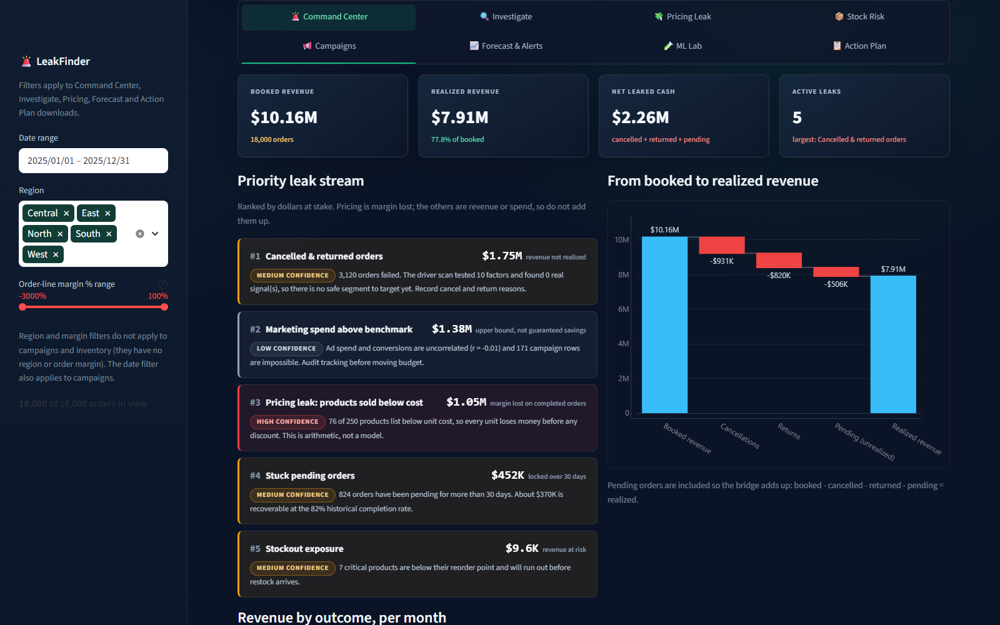
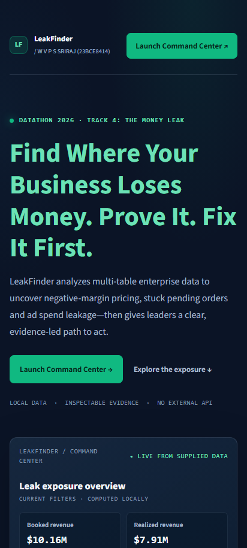

# LeakFinder

LeakFinder is a local Streamlit dashboard for finding and investigating possible financial leaks in retail data. It was built for Datathon 2026, Track 4: The Money Leak.

The dashboard works with the supplied CSV files, explains how it reaches its findings, and provides action queues that can be downloaded. It does not call external APIs.

**Author:** W V P S SRIRAJ (23BCE8414)

## Screenshots

### Overview



### Command Center



### Mobile view



## Run the App

Requirements: Python 3.10 or newer.

From the project folder, create and activate a virtual environment, install the packages, and start Streamlit:

```powershell
python -m venv .venv
.\.venv\Scripts\Activate.ps1
python -m pip install -r requirements.txt
streamlit run app2.py
```

On macOS or Linux, activate the environment with:

```bash
source .venv/bin/activate
```

The dashboard opens at `http://localhost:8501`. The CSV files must remain in the `data/` folder.

## Dashboard Sections

The dashboard has eight tabs:

1. **Command Center** ranks the largest money-at-stake signals and shows how booked revenue becomes realized revenue.
2. **Investigate** compares cancellation and return rates across regions, categories, customer segments, and payment methods.
3. **Pricing Leak** finds products listed below cost and includes a what-if repricing simulator.
4. **Stock Risk** checks inventory against demand, reorder points, and supplier restock time.
5. **Campaigns** reviews campaign tracking, spend, conversions, and channel economics.
6. **Forecast & Alerts** shows sales forecasts and unusual changes over time.
7. **ML Lab** compares models using a time-based test set and baseline metrics.
8. **Action Plan** provides prioritized tasks and downloadable work queues.

Date, region, and margin filters are available in the sidebar. Some filters do not apply to inventory or campaign data because those tables do not contain the same fields.

## Data

The supplied dataset is synthetic and for educational use. It contains:

| File | Rows | What it contains |
| --- | ---: | --- |
| `customers.csv` | 3,000 | Customer information and segments |
| `products.csv` | 250 | Product categories, costs, and list prices |
| `transactions.csv` | 18,000 | Order lines, prices, dates, and outcomes |
| `inventory.csv` | 5,000 | Inventory snapshots and stock information |
| `campaigns.csv` | 1,200 | Campaign spend, clicks, impressions, and conversions |

Transactions join to customers through `customer_id`, and to products through `product_id`. Inventory also uses `product_id`. Campaigns are reviewed by date and channel/category where available. More dataset notes are in [`data/README.txt`](data/README.txt).

## How to Read the Results

- Completed orders count as realized revenue. Cancelled and returned orders do not.
- `unit_price` already includes the discount, so discounts are not subtracted a second time.
- Pending orders older than 30 days are treated as stuck.
- The source data does not specify a currency. The dashboard displays `$` as an assumption.
- Costs and prices were generated independently. Confirm product costs and recommended prices with Finance before changing real prices.
- Inventory risk is calculated from stock, demand, reorder points, and restock timing. The supplied stockout flag is not trusted on its own.
- A statistical difference is not automatically a real business cause. Driver scans and model results are shown with their test evidence and limitations.

## Project Files

```text
app2.py                 Streamlit application
data/                   Five input CSV files and dataset notes
leak_engine.py          Shared calculations used to prepare the presentation data
ml_scratch.py           NumPy machine-learning implementations
pipeline.py             Feature preprocessing and model helpers
gen_deck_json.py        Builds presentation data from the analysis engine
deck.json               Generated presentation content
build_deck.js           Builds a PowerPoint from deck.json
screenshots/            Current app screenshots used in this README and deck
LeakFinder_Round1_Final.pptx
                        Presentation with the app screenshots appended
requirements.txt        Python dependencies for the app
```

The `models/analysis.pkl` file is a generated cache, not an input. The analysis engine recreates it when needed. The separate `new/` UI bundle is not used by `app2.py`.

## Build the Presentation

The presentation with the app screenshots is available here: [LeakFinder_Round1_Final.pptx](LeakFinder_Round1_Final.pptx).

To rebuild the original data-driven presentation, install Node.js and the `pptxgenjs` package, then run:

```bash
npm install pptxgenjs
python gen_deck_json.py
node build_deck.js deck.json LeakFinder_Round1.pptx
```

The generated presentation is written to `LeakFinder_Round1.pptx`.

## Deploy

For Streamlit Community Cloud, push this repository to GitHub and create an app using `app2.py` as the main file. Keep the `data/` folder in the repository so the app can load its CSV files.

## License and Data Note

No license file is included. The dataset notes identify the supplied data as synthetic educational data, not real company data.