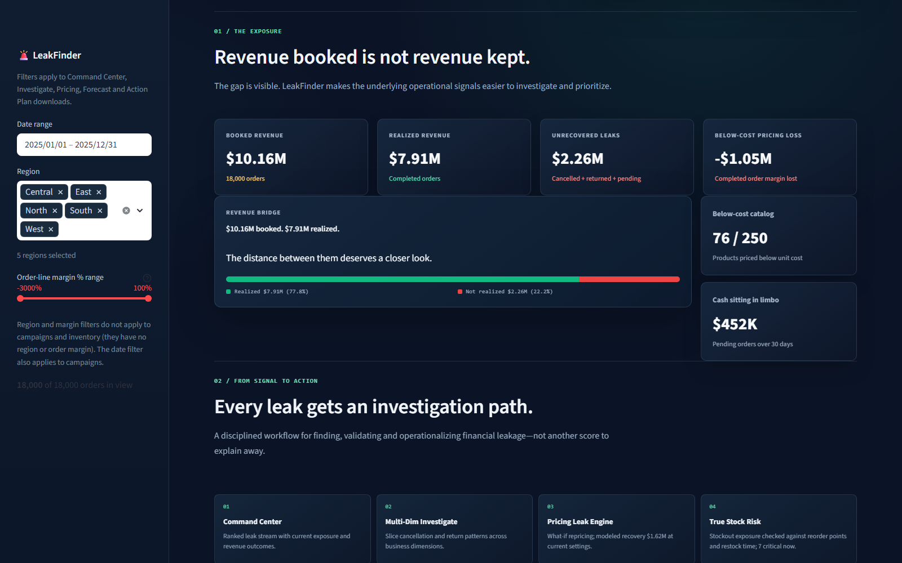

# 🚨 LeakFinder — Enterprise Money Leak Intelligence Platform

> **Datathon 2026 | Track 4: The Money Leak**  
> **Author:** W V P S SRIRAJ (23BCE8414)  
> **Tech Stack:** Python 3.10+, Streamlit, Plotly, Pandas, NumPy (No external API calls)

---

## 📌 Executive Overview

**LeakFinder** is an executive-grade decision-support dashboard designed to locate, quantify, and operationalize financial leakage across enterprise retail data. Rather than serving as another passive BI tool or outputting arbitrary black-box risk scores, LeakFinder connects **5 relational datasets** to pinpoint verified deterministic loss drivers and export actionable, prioritized execution queues.

In the benchmark dataset, LeakFinder uncovered a **$2.25M net revenue gap** ($10.16M booked vs. $7.91M realized revenue, representing a 17.2% cancellation and return loss).

### Key Financial Discoveries
* **$1.05M Negative-Margin Pricing Loss:** 76 of 250 catalog products are listed below unit cost. Promotional discounts add only $22K in extra losses, proving that base pricing architecture—not discounting—is the root problem.
* **$370K Stuck Working Capital:** Orders sitting in `Pending` status for over 30 days lock up critical liquidity.
* **Ad Spend Disconnect ($r = -0.01$):** Campaign spend shows zero correlation with conversions. Data cleaning removed 171 corrupted campaign records (clicks > impressions or conversions > clicks).
* **Up to $1.62M Recovery Potential:** What-if repricing simulation demonstrates that establishing a 20% target margin floor recovers up to $1.62M in net margin, even after factoring in a 15% elasticity volume drop.
* **"Honest Data Science" USP:** Built entirely from scratch using pure NumPy (Logistic Regression, Random Forest, Gradient Boosting) with time-aware train/test splits (Jan–Sep train, Oct–Dec test). Achieving a test AUC of 0.52 (coin-flip level), LeakFinder **explicitly suppresses uninformative predictive risk scores** to focus 100% on verified deterministic math.

---

## 📸 Screenshots

### Overview


### Command Center


### Exposure & Revenue Waterfall Bridge


### Mobile Responsive View


---

## ⚡ Quick Start: Run the App Locally

**Prerequisites:** Python 3.10 or newer.

1. **Clone the repository & enter the project directory:**
   ```bash
   git clone https://github.com/your-username/LeakFinder.git
   cd LeakFinder
   ```

2. **Set up a virtual environment:**

   * **Windows (PowerShell):**
     ```powershell
     python -m venv .venv
     .\.venv\Scripts\Activate.ps1
     ```

   * **macOS / Linux:**
     ```bash
     python -m venv .venv
     source .venv/bin/activate
     ```

3. **Install dependencies and launch Streamlit:**
   ```bash
   python -m pip install -r requirements.txt
   streamlit run app2.py
   ```

4. **Access the Application:** Open `http://localhost:8501` in your browser. Ensure the five CSV input files remain in the `./data/` folder.

---

## 🖥️ Dashboard Architecture (8 Operational Modules)

The Streamlit dashboard (`app2.py`) provides an 8-tab investigation workflow:

1. **🚨 Command Center:** Displays top-line financial metrics, a dollar-ranked priority alert stream, monthly revenue outcome bars, and a waterfall bridge tracing booked to realized revenue.
2. **🔍 Investigate:** Multi-dimensional failure slicing (Region, Category, Segment, Payment Method) with Bonferroni-corrected z-score statistical driver scans and lead-time analysis.
3. **💸 Pricing Leak:** Identifies products priced below cost and provides an interactive "What-If" repricing simulator with target margin floor and volume elasticity controls.
4. **📦 Stock Risk:** Replaces flawed stockout flags with a 90-day sales velocity model comparing stock-on-hand against supplier lead/delay times to surface high-risk products and overstock capital lockup.
5. **📢 Campaigns:** Evaluates marketing spend vs. real conversions, filters corrupt tracking rows, and analyzes acquisition costs (CAC) against customer lifetime margin.
6. **📈 Forecast & Alerts:** Applies rolling Z-score anomaly detection to identify daily revenue spikes/drops and projects 30-day revenue trends.
7. **🧪 ML Lab:** Evaluates from-scratch NumPy classification models using a time-aware split (Jan–Sep train, Oct–Dec test) and documents why weak predictive scores are suppressed.
8. **📋 Action Plan:** Interactive operational task checklist paired with direct CSV download buttons for work queues (`Repricing List`, `Stuck Orders Queue`, `Ad Spend Audit`).

*Note: Date, region, and margin filters are available in the sidebar.*

---

## 📊 Dataset Structure & Cleaning Rules

The dataset consists of 5 relational CSV tables located in `./data/`:

| File | Rows | Description | Key Join Keys / Usage |
| :--- | :---: | :--- | :--- |
| `customers.csv` | 3,000 | Customer profiles, geographic regions, and segments | `customer_id` |
| `products.csv` | 250 | Catalog details, unit costs, and list prices | `product_id` |
| `transactions.csv` | 18,000 | Line-item order history, prices, timestamps, and status | `transaction_id`, `customer_id`, `product_id` |
| `inventory.csv` | 5,000 | Historical inventory snapshots, reorder points, stock counts | `product_id`, `date` |
| `campaigns.csv` | 1,200 | Marketing spend, impressions, clicks, and conversions | `date`, `channel`, `category` |

### Key Cleaning Rules & Assumptions
* **Realized Revenue:** Completed orders represent realized revenue. Cancelled and returned orders do not generate revenue.
* **Unit Price Verification:** `unit_price` in transactions already reflects applied discounts (verified on all 18,000 lines), preventing double-discount deductions.
* **Stuck Orders:** Orders in `Pending` status for longer than 30 days are classified as stuck working capital.
* **Campaign Integrity:** 171 campaign records with impossible metrics (`clicks > impressions` or `conversions > clicks`) are flagged and excluded from correlation and conversion totals.
* **Inventory Audit:** Raw `stockout_flag` values are unreliable (760 of 760 flagged snapshot records had stock on hand). Stockout exposure is computed dynamically from daily demand velocity and supplier restock lead times.
* **Currency:** Currency is unstated in raw data; USD (`$`) is assumed throughout.

---

## 🛠️ Repository Directory Tree

```text
LeakFinder/
├── app2.py                           Main Streamlit dashboard application
├── leak_engine.py                    Core financial calculations & data preprocessing engine
├── ml_scratch.py                     Pure NumPy machine learning implementations (from scratch)
├── pipeline.py                       Feature engineering, scaling, and imputation pipeline
├── gen_deck_json.py                  Exports analysis output to structured presentation JSON
├── deck.json                         Generated presentation content
├── build_deck.js                     PowerPoint generation script (Node.js pptxgenjs)
├── requirements.txt                  Python dependencies
├── LeakFinder_Round1_Final_updated.pptx Refreshed presentation with latest app screenshots
├── data/                             Input CSV datasets & dataset documentation
│   ├── customers.csv
│   ├── products.csv
│   ├── transactions.csv
│   ├── inventory.csv
│   ├── campaigns.csv
│   └── README.txt
└── screenshots/                      App UI screenshots for README and presentation deck
    ├── leakfinder-overview.png
    ├── leakfinder-command-center.png
    ├── leakfinder-exposure.png
    └── leakfinder-mobile.png
```

---

## 📢 Build the Presentation Deck

The updated presentation deck containing the latest UI screenshots is available at [`LeakFinder_Round1_Final_updated.pptx`](LeakFinder_Round1_Final_updated.pptx).

To programmatically rebuild the presentation deck from raw data analysis:

1. **Install Node.js dependencies:**
   ```bash
   npm install pptxgenjs
   ```

2. **Generate structured presentation JSON and build `.pptx`:**
   ```bash
   python gen_deck_json.py
   node build_deck.js deck.json LeakFinder_Round1.pptx
   ```

---

## 🌐 Cloud Deployment

To deploy **LeakFinder** on **Streamlit Community Cloud**:

1. Push this repository to GitHub.
2. Log into Streamlit Cloud, connect your repository, and select `app2.py` as the entrypoint file.
3. Ensure the `./data/` folder is committed to the repository so the CSV tables load automatically.

---

## 📜 License & Dataset Note

This project is built for **Datathon 2026 (Track 4: The Money Leak)**. The provided dataset is synthetic educational data for benchmarking purposes. Confirm product costs and pricing structures with internal finance teams prior to implementing real-world repricing strategies.
